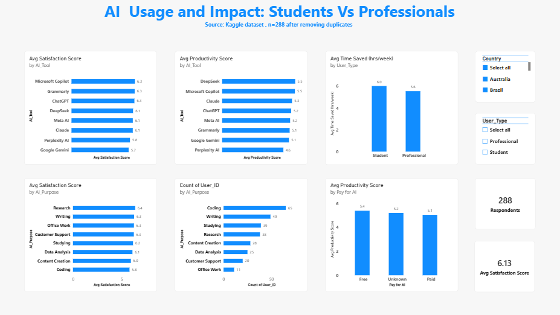

# AI Usage and Impact: Students vs Professionals

A Power BI dashboard that explores how students and professionals use AI tools, and how satisfied and productive they report being.

**Source:** Kaggle dataset "AI Usage and Impact on Students and Professionals" (300 rows, 19 columns).
**Tools:** Power BI (Power Query, DAX)

## Questions

1. Which AI tools have the highest average satisfaction and productivity scores?
2. Do students or professionals save more hours per week?
3. What do people mainly use AI for, and does satisfaction differ by purpose?
4. Do people who pay for AI report higher productivity than free users?

## Data cleaning (Power Query)

- Removed 12 exact duplicate rows (repeated `User_ID`), leaving 288 respondents.
- Standardized inconsistent labels in `Gender`, `Country`, `AI_Tool` and `Education_Level` (for example "chatgpt", "Chat GPT" and "Chatgpt" became "ChatGPT").
- Removed text units (`yrs`, `hrs`, `$`, `,`) from `Age`, the hours columns, `Monthly_Income` and `Monthly_AI_Cost`, then converted them to numbers.
- Replaced blank category values with "Unknown".
- Numeric blanks:"left empty so averages skip them".

## Findings

These are patterns in this sample of 288 people. They do not show cause and effect.

- **Tools:** Average satisfaction ranges from 5.7 (Google Gemini) to 6.3 (Microsoft Copilot, Grammarly, ChatGPT). The spread is narrow, and some tools have only about 10 users.
- **Purpose:** Coding is the most common use (65 respondents) but has the lowest average satisfaction (5.8). Research has the highest (6.4).
- **Students vs professionals:** Students report saving 6.0 hours per week and professionals 5.6, a small difference.
- **Paid vs free:** Free users report an average productivity of 5.4 and paid users 5.1, so paying for AI was not linked to higher productivity here.
- Overall average satisfaction is 6.13.
- The two tool charts exclude respondents whose tool was blank, so they cover fewer than 288 people.

## Limitations

- Small sample (288 respondents), and some groups are very small.
- The data is self-reported, and I don't know how the survey was collected.
- Satisfaction and productivity differences between groups are small, so I would not draw strong conclusions from them.

## Next steps

- "Repeat the analysis on a larger dataset".

## Files

- `AI_Usage_Dashboard.pbix`: Power BI report
- `AI_Usage_and_Impact_on_Students_and_Professionals.csv`: original data
- `dashboard.png`: screenshot
